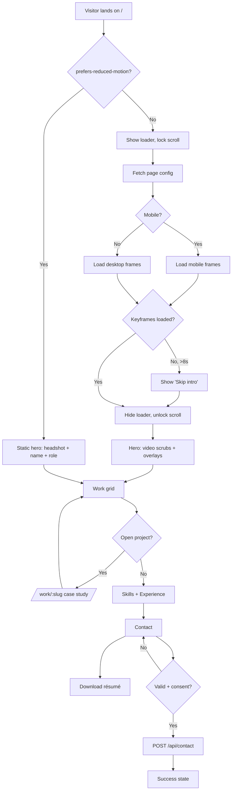
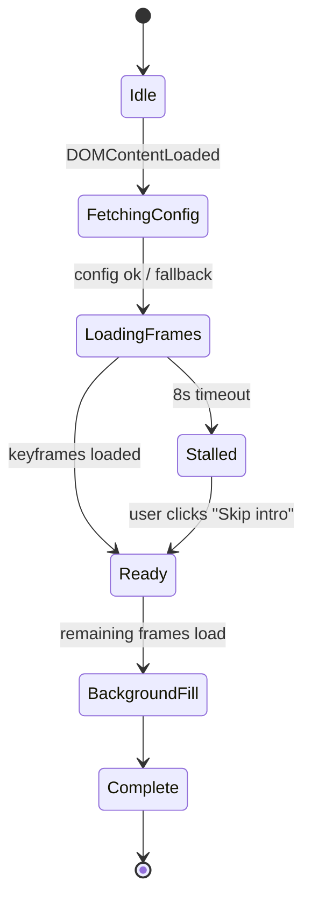
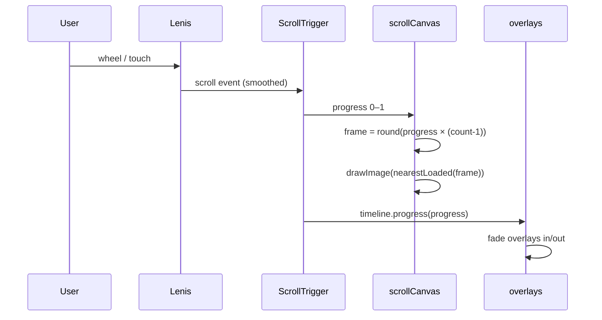
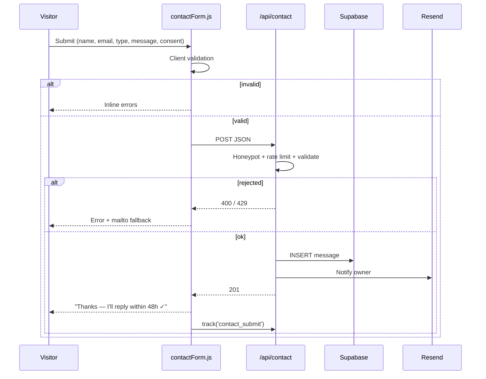
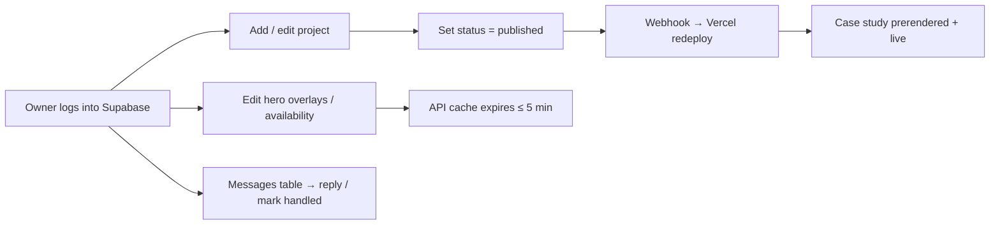
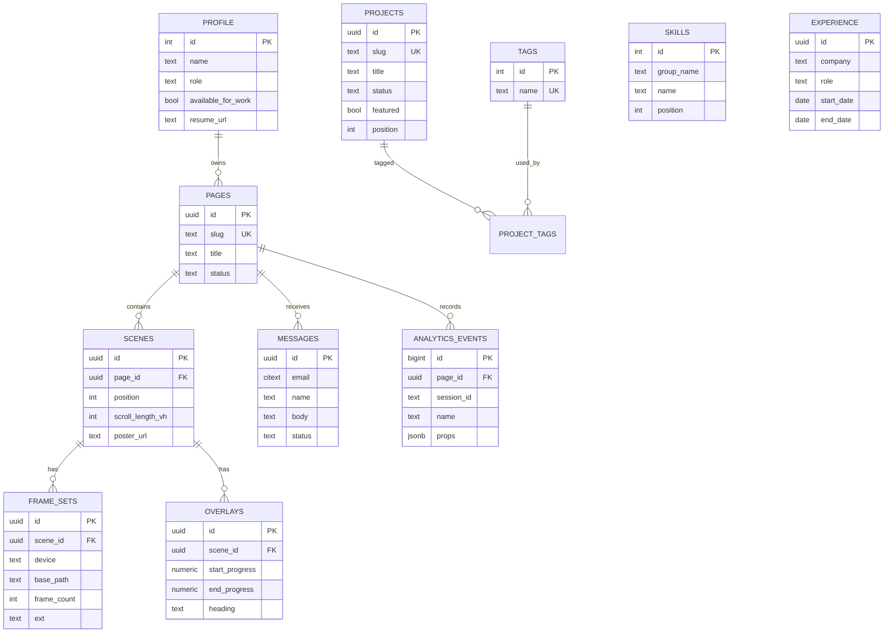
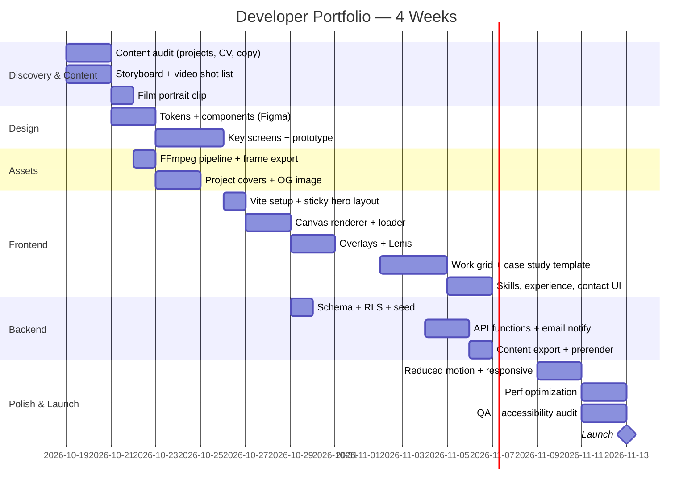

# Developer Portfolio with a Scroll-Driven Video Hero: Planning Docs

I've turned the product-landing-page docs into a plan for a **personal portfolio for a web developer**. Here's what changed:

- **Hero:** the scroll-controlled video now shows the developer. Your headshot (black blazer, white shirt, light grey studio background) is the poster image, the Open Graph (OG) share image and the reduced-motion fallback.
- **Content:** "Product features" became **Work, Skills, Experience and Contact**.
- **Lead form:** it's now a **contact form** that sends project and hiring enquiries.
- **Backend:** it also serves **projects, skills and experience**, so you can update your portfolio without redeploying.
- **Timeline:** the plan is now **4 weeks for one developer**, not a 6-week team project.

Replace `[Your Name]`, `[you@email.com]` and similar placeholders with your details.

```
portfolio-scroll-site/
└── docs/
    ├── 01-PRD.md
    ├── 02-TRD.md
    ├── 03-APP-FLOW.md
    ├── 04-UI-UX-DESIGN-BRIEF.md
    ├── 05-BACKEND-SCHEMA.md
    └── 06-IMPLEMENTATION-PLAN.md
```

---

## 📄 `docs/01-PRD.md`

````markdown
# Product Requirements Document (PRD)
**Product:** [Your Name] — Developer Portfolio (Scroll-Driven Video Hero)
**Version:** 1.0 · **Status:** Draft · **Last updated:** 2026-10-13

## 1. Overview
A personal portfolio website for a web developer. The hero section is a
cinematic, scroll-controlled video of the developer: scrolling moves the
footage forward and backward frame by frame, and text overlays introduce who
they are and what they build. Below the hero are selected projects (with case
study pages), skills, experience and a contact form.

The site doubles as a live demo of the developer's skills. Its performance,
polish and accessibility are part of the pitch.

## 2. Problem Statement
Most developer portfolios look the same: a template, a list of projects and a
GitHub link. Recruiters and clients spend under a minute on each one. A
memorable, high-performance interactive experience makes the developer stand
out and shows frontend skill without needing any explanation.

## 3. Goals
| # | Goal | Metric |
|---|---|---|
| G1 | Make a strong first impression | Avg. scroll depth ≥ 60% |
| G2 | Turn visits into opportunities | Contact submit or résumé download ≥ 3% of sessions |
| G3 | Show engineering quality | Lighthouse Perf ≥ 90, A11y ≥ 95, SEO ≥ 95 |
| G4 | Keep the portfolio fresh | Add or edit a project in < 5 min, no redeploy |

## 4. Non-Goals (v1)
- Blog / articles (planned for v2)
- Custom admin UI (the Supabase dashboard is used instead)
- Multi-language support
- WebGL / 3D scenes

## 5. Target Users
| Persona | Description | Need |
|---|---|---|
| **Recruiter / Hiring Manager** | Skims many portfolios, often on desktop | Who is this, what is their stack, where is the CV? |
| **Freelance Client** | Founder or agency, often on mobile | Proof of results, easy way to get in touch |
| **Fellow Developer** | Curious about the craft | Source code, technical write-ups |
| **Owner (the developer)** | Maintains the content | Fast updates to projects and status |

## 6. User Stories
| ID | As a… | I want to… | So that… |
|---|---|---|---|
| US-1 | Visitor | have the hero video respond to my scroll | the first impression is memorable |
| US-2 | Visitor | scroll back smoothly | I can replay the intro |
| US-3 | Visitor | see a loading indicator | I know something is coming |
| US-4 | Recruiter | see name, role and stack within 10s | I can qualify the candidate quickly |
| US-5 | Recruiter | download the résumé as a PDF | I can share it internally |
| US-6 | Client | browse projects and open a case study | I can judge the quality of the work |
| US-7 | Client | send a project enquiry | I can start a conversation |
| US-8 | Visitor (reduced motion) | get a static version | I avoid motion discomfort |
| US-9 | Owner | add projects and edit hero text in a dashboard | I don't have to redeploy |
| US-10 | Owner | set an "Available for work" status | visitors know whether I'm open to offers |

## 7. Functional Requirements
| ID | Requirement | Priority |
|---|---|---|
| FR-1 | Scroll position maps 1:1 to a video frame inside a sticky hero section | P0 |
| FR-2 | Canvas image-sequence renderer with `object-fit: cover` behavior | P0 |
| FR-3 | Preloader with % progress; scroll locked until keyframes load | P0 |
| FR-4 | Hero text overlays fade in and out at configured progress ranges (0–1) | P0 |
| FR-5 | Smooth scrolling (Lenis) synced with ScrollTrigger | P1 |
| FR-6 | Separate mobile frame set (smaller resolution and count) | P0 |
| FR-7 | Reduced-motion fallback (static headshot + stacked text) | P0 |
| FR-8 | Projects grid with tag filter; featured projects first | P0 |
| FR-9 | Case study page per project at `/work/:slug` (problem, role, stack, outcome, links) | P0 |
| FR-10 | Skills section (grouped) and experience timeline | P0 |
| FR-11 | Contact form (name, email, message, budget/type) with validation and spam protection | P0 |
| FR-12 | Résumé PDF download + social links (GitHub, LinkedIn, email) | P0 |
| FR-13 | "Available for work" badge driven by config | P1 |
| FR-14 | All content loaded from the API, with a static JSON fallback | P1 |
| FR-15 | Analytics: scroll milestones, project opens, résumé downloads, contact submits | P1 |
| FR-16 | Per-page SEO: meta, OG image, JSON-LD `Person` schema | P1 |

## 8. Non-Functional Requirements
| Category | Requirement |
|---|---|
| Performance | LCP < 2.5s, CLS < 0.05, INP < 200ms; frames ≤ 10 MB desktop / ≤ 4 MB mobile |
| Smoothness | ≥ 55 fps while scrubbing on a 2022 mid-range Android |
| Compatibility | Last 2 versions of Chrome, Safari, Firefox, Edge; iOS 15+ |
| Accessibility | WCAG 2.2 AA, fully keyboard navigable |
| SEO | Real HTML text, prerendered case studies, sitemap.xml |
| Security | Rate-limited contact endpoint, no secrets on the client, consent checkbox |
| Availability | 99.9% (static CDN hosting) |

## 9. Scope
**MVP (v1):** FR-1 to FR-12, FR-15
**v1.1:** FR-13, FR-14, FR-16
**v2:** Blog, dark/light toggle, i18n, multiple scroll scenes (e.g. one per case study)

## 10. Assumptions & Dependencies
- Source footage is a 4–6s clip of the developer at 1080p+, filmed against the
  same light grey studio/office backdrop as the headshot, with no baked-in text.
  If no clip is filmed, an image-to-video clip generated from the headshot is an
  acceptable placeholder.
- The headshot (`/public/posters/portrait.jpg`) is the poster, the OG image
  base and the reduced-motion hero.
- Hosting on Vercel; data on Supabase (Postgres).
- GSAP (including ScrollTrigger) is free to use under its standard license.

## 11. Risks
| Risk | Impact | Mitigation |
|---|---|---|
| Large frame payload on slow networks | Visitors bounce before seeing work | Progressive loading, mobile set, AVIF, short clip |
| Animation hides the actual content | Recruiters leave | Hero ≤ 300vh, "Skip to work" link, name/role visible at 0% |
| iOS Safari quirks | Broken scrub | Canvas method (not `<video>`) |
| Motion sickness | Accessibility complaints | `prefers-reduced-motion` fallback |
| Contact spam | Inbox noise | Honeypot + rate limit (+ Turnstile if needed) |

## 12. Release Criteria
- All P0 requirements done and tested on the device matrix
- Lighthouse: Performance ≥ 90, Accessibility ≥ 95, SEO ≥ 95
- At least 3 complete case studies published
- Résumé PDF current; all external links checked
- No open P0/P1 bugs
````

---

## 📄 `docs/02-TRD.md`

````markdown
# Technical Requirements Document (TRD)
**Related:** [PRD](./01-PRD.md) · [Backend Schema](./05-BACKEND-SCHEMA.md)

## 1. Architecture Overview
```
┌──────────────────────────── Browser ─────────────────────────────┐
│  index.html, work/<slug>/index.html (prerendered at build)        │
│   ├─ main.js ─────────── bootstraps modules                       │
│   ├─ contentLoader.js ── GET /api/page/:slug (fallback: JSON)     │
│   ├─ scrollCanvas.js ─── preload frames → draw on <canvas>        │
│   ├─ overlays.js ─────── GSAP timeline from content config        │
│   ├─ smoothScroll.js ─── Lenis ↔ ScrollTrigger                    │
│   ├─ projects.js ─────── grid, tag filter, reveal animations      │
│   ├─ contactForm.js ──── POST /api/contact                        │
│   └─ analytics.js ────── POST /api/events (sendBeacon)            │
└──────────────┬────────────────────────────────┬──────────────────┘
               │ static assets                  │ API calls
        ┌──────▼──────┐                  ┌──────▼────────────────┐
        │ Vercel CDN  │                  │ Vercel Serverless     │
        │ /frames/*   │                  │ /api/page, /api/      │
        │ /resume.pdf │                  │ projects, /api/contact│
        │ immutable   │                  │ /api/events           │
        └─────────────┘                  └──────┬────────────────┘
                                                │ service-role key
                                         ┌──────▼──────┐   ┌──────────┐
                                         │  Supabase   │──▶│ Resend   │
                                         │  Postgres   │   │ (email   │
                                         │  + Storage  │   │  notify) │
                                         └─────────────┘   └──────────┘
```

## 2. Tech Stack
| Layer | Choice | Reason |
|---|---|---|
| Build | Vite 5 (multi-page) | Fast, static output, easy prerender |
| Language | Vanilla JS (ES2022 modules) | No framework overhead; shows fundamentals |
| Animation | GSAP 3 + ScrollTrigger | Reliable scrub and reveals |
| Smooth scroll | Lenis | Lightweight, works with ScrollTrigger |
| Rendering | Canvas 2D + AVIF/WebP sequence | Smooth across browsers |
| Hosting | Vercel | CDN + serverless in one place |
| Database | Supabase Postgres | Dashboard doubles as the CMS |
| Email | Resend | New-message notifications |
| Asset processing | FFmpeg, Sharp | Frame extraction, image resizing |
| Analytics | Custom events table (+ optional Plausible) | Privacy-friendly |

## 3. Frontend Modules
| Module | Responsibility | Public API |
|---|---|---|
| `contentLoader.js` | Fetch config, fall back to `/content/*.json` | `loadContent(slug) → Promise<PageConfig>` |
| `scrollCanvas.js` | Preload, resize, render frames | `initScrollCanvas({ scene, onProgress, onComplete })` |
| `overlays.js` | Build overlay DOM and timeline | `initOverlays(overlays[])` |
| `smoothScroll.js` | Lenis setup | `initSmoothScroll() → lenis` |
| `projects.js` | Render grid, filter by tag, reveal on scroll | `initProjects(projects[], el)` |
| `contactForm.js` | Validate and submit | `initContactForm(formEl)` |
| `analytics.js` | Track events, batched | `track(name, props)` |

### 3.1 PageConfig Contract
```ts
type PageConfig = {
  slug: string;
  title: string;
  profile: {
    name: string;
    role: string;                    // "Full-Stack Web Developer"
    location: string;
    availableForWork: boolean;
    resumeUrl: string;
    socials: { github?: string; linkedin?: string; email?: string };
  };
  scenes: Array<{
    id: string;
    scrollLengthVh: number;          // hero: 300
    frames: {
      desktop: { basePath: string; count: number; ext: 'webp' | 'avif' };
      mobile:  { basePath: string; count: number; ext: 'webp' | 'avif' };
    };
    posterUrl: string;               // headshot; reduced-motion / noscript
    overlays: Array<{
      id: string;
      start: number;                 // 0–1
      end: number;                   // 0–1
      heading: string;
      body?: string;
      cta?: { label: string; href: string };
      align: 'center' | 'left' | 'right';
    }>;
  }>;
  projects: Project[];               // featured first, by position
  skills: Array<{ group: string; items: string[] }>;
  experience: Array<{ company: string; role: string; start: string; end?: string; summary: string }>;
};

type Project = {
  slug: string; title: string; summary: string; year: number;
  tags: string[]; coverUrl: string; liveUrl?: string; repoUrl?: string;
  featured: boolean;
  caseStudy?: { problem: string; role: string; solution: string; outcome: string; images: string[] };
};
```

### 3.2 Content Loading With Fallback
```js
// src/contentLoader.js
export async function loadContent(slug = 'home') {
  try {
    const res = await fetch(`/api/page/${slug}`, { signal: AbortSignal.timeout(2500) });
    if (!res.ok) throw new Error(res.status);
    return await res.json();
  } catch {
    return (await fetch(`/content/${slug}.json`)).json();   // static fallback
  }
}
```

## 4. Rendering Pipeline
1. `matchMedia('(max-width: 768px)')` picks the desktop or mobile frame set.
2. Frames preload in progressive order (every 4th → every 2nd → all).
3. The loader hides once **keyframes (every 4th)** have loaded. The rest load in
   the background.
4. ScrollTrigger maps `progress (0–1)` → `frameIndex = round(progress × (count − 1))`.
5. `render()` draws the nearest loaded frame. Canvas DPR is capped at 2.
6. Name and role are real HTML, visible at progress 0 (good for LCP and SEO).

## 5. Case Study Pages (Prerender)
- `npm run export:content` pulls published content from Supabase and writes
  `/public/content/home.json` and `/public/content/projects/<slug>.json`.
- A Vite plugin prerenders `/work/<slug>/index.html` from a template, so each
  case study has real HTML, meta tags and an OG image.
- A Supabase database webhook triggers a Vercel deploy hook when a project is
  published, so the prerendered pages stay current.

## 6. Performance Budgets
| Asset | Desktop | Mobile |
|---|---|---|
| JS (gzipped) | ≤ 60 KB | ≤ 60 KB |
| CSS (gzipped) | ≤ 12 KB | ≤ 12 KB |
| Hero frames total | ≤ 10 MB (120 × ~80 KB) | ≤ 4 MB (90 × ~40 KB) |
| Project cover images | AVIF, ≤ 120 KB each, lazy-loaded | ≤ 60 KB each |
| Time to interactive scrub | ≤ 3s on 4G | ≤ 4s on 4G |
| Main-thread work per frame | ≤ 8 ms | ≤ 12 ms |

## 7. Browser Support
- Chrome/Edge/Firefox: last 2 versions
- Safari macOS 15+, iOS 15+
- `<noscript>`: headshot + all text and project links

## 8. API Contract (summary — details in Backend Schema)
| Method | Endpoint | Auth | Purpose |
|---|---|---|---|
| GET | `/api/page/:slug` | Public | Full page config (cached 5 min) |
| GET | `/api/projects/:slug` | Public | Single case study (cached 5 min) |
| POST | `/api/contact` | Public + rate limit | Create message, email notify |
| POST | `/api/events` | Public + rate limit | Batch analytics events |

## 9. Security
- The Supabase **service-role key and Resend key live only in Vercel env vars**.
- Contact: server-side validation, honeypot, rate limit 3/10 min per IP hash.
- IPs are stored only as a salted SHA-256 hash.
- CSP: `default-src 'self'; img-src 'self' data: https://*.supabase.co; connect-src 'self'`.
- A consent checkbox is required; its timestamp is stored.
- External links use `rel="noopener noreferrer"`.

## 10. Environment Variables
| Name | Where | Description |
|---|---|---|
| `SUPABASE_URL` | Server | Project URL |
| `SUPABASE_SERVICE_ROLE_KEY` | Server | Server-only key |
| `IP_HASH_SALT` | Server | Salt for IP hashing |
| `RESEND_API_KEY` | Server | Email notifications |
| `CONTACT_NOTIFY_TO` | Server | Owner inbox, e.g. `[you@email.com]` |
| `VITE_PAGE_SLUG` | Client | Default slug (`home`) |

## 11. Error Handling
| Failure | Behavior |
|---|---|
| API down | Static JSON fallback |
| Frame 404 | Skip it; render the nearest loaded frame |
| Frames slow (> 8s) | "Skip intro" button; enable scroll with partial frames |
| Contact submit fails | Inline error, keep the values, show a `mailto:` fallback link |
| Email notify fails | Message is still saved; error logged |

## 12. Testing Strategy
| Type | Tool | Scope |
|---|---|---|
| Unit | Vitest | frame index math, overlay timing, validation, tag filter |
| E2E | Playwright | loader → hero scroll → project open → contact submit |
| Visual | Playwright screenshots at 0/25/50/75/100% hero | regressions |
| Performance | Lighthouse CI | budgets in §6 |
| Manual | Real devices + BrowserStack | iOS Safari, Android Chrome |

## 13. CI/CD
- GitHub → Vercel preview deploy on every PR
- GitHub Actions: lint → unit → export:content → build → Lighthouse CI
- Merge to `main` → production deploy; the content-publish webhook → redeploy
````

---

## 📄 `docs/03-APP-FLOW.md`

````markdown
# App Flow
**Related:** [PRD](./01-PRD.md) · [TRD](./02-TRD.md)

## 1. Site Map
```
/ (Home)
├── #hero        Sticky canvas: scroll-scrubbed portrait video + overlays
├── #work        Featured projects grid + tag filter
├── #skills      Grouped stack (Frontend / Backend / Tools)
├── #experience  Timeline
├── #contact     Contact form + socials + résumé download
└── footer       © · Privacy · Source code link
/work/:slug      Case study page
/resume.pdf
/privacy
/404
```

## 2. Visitor Journey


> A "Skip to work" link (first focusable element) jumps straight to `#work`.

## 3. Loader State Machine


## 4. Scroll → Render Loop


## 5. Hero Timeline (default content)
```
progress  0.0 ──── 0.25 ──── 0.50 ──── 0.75 ──── 1.0
frames    1 ───────────────────────────────────── 120
camera    wide mid-shot ──── slow dolly-in ──── close-up, eye contact
overlay1  [██ Hi, I'm [Your Name] ██]                       (center, visible at 0)
overlay2            [██ I build fast, beautiful web apps ██] (left)
overlay3                      [██ React · Node · Postgres ██] (right)
overlay4                                [██ Let's build yours → View work ██]
canvas                                        [scale 1 → 0.9, radius → 24px]
analytics ▲25%       ▲50%       ▲75%       ▲100%   (scroll_milestone)
```

## 6. Contact Form Flow


## 7. Owner (Editor) Flow


## 8. Error & Edge States
| Situation | What the user sees |
|---|---|
| JS disabled | `<noscript>` headshot + all text + project links |
| API unavailable | Normal experience from static JSON |
| Slow network | Progress bar → "Skip intro" |
| Window resized mid-scroll | Canvas resizes, frame redrawn, ScrollTrigger refreshes |
| Mobile rotation | Same as resize; frame set does not switch mid-session |
| Unknown `/work/:slug` | Custom 404 with a link back to Work |
| Filter returns no projects | "No projects with this tag yet" + reset button |
````

---

## 📄 `docs/04-UI-UX-DESIGN-BRIEF.md`

````markdown
# UI/UX Design Brief
**Related:** [PRD](./01-PRD.md) · [App Flow](./03-APP-FLOW.md)

## 1. Project Summary
A clean, editorial portfolio. The hero is a scroll-scrubbed portrait video of
the developer. Everything after it is calm, readable and fast, so the work
speaks for itself.

## 2. Objectives
1. **Memorable in 3 seconds:** the first scroll feels cinematic.
2. **Qualify in 10 seconds:** name, role and stack are visible immediately.
3. **Proof over claims:** projects show outcomes, not just screenshots.
4. **Easy to reach:** contact and CV are never more than one click away.

## 3. Audience
Recruiters, hiring managers and founders aged 25–50. About 55% desktop
(recruiters) and 45% mobile (clients from social links).

## 4. Brand & Tone
| Attribute | Is | Is not |
|---|---|---|
| Voice | Confident, direct, human | Buzzword-heavy, arrogant |
| Visual | Light, editorial, spacious; sharp black/white contrast like the suit and shirt in the headshot | Neon, cluttered, template-y |
| Motion | Smooth, purposeful | Bouncy, gimmicky, slow |

## 5. Design Principles
1. **The person is the brand.** The hero focuses on the developer; the UI recedes.
2. **One message per screen.** Hero headlines ≤ 6 words.
3. **Motion follows scroll.** No autoplay in the hero.
4. **Content first after the hero.** Reveals are quick (≤ 400ms) and never block reading.

## 6. Design Tokens
### Color (light theme, matched to the headshot backdrop)
| Token | Value | Use |
|---|---|---|
| `--bg` | `#F2F2F0` | Page background (blends with the light grey video backdrop) |
| `--surface` | `#FFFFFF` | Cards, form |
| `--fg` | `#0B0B0C` | Primary text |
| `--fg-muted` | `#5F6368` | Secondary text |
| `--line` | `#E2E2DF` | Borders, dividers |
| `--accent` | `#3355FF` | CTA, links, focus ring |
| `--inverse-bg` | `#0B0B0C` | Contact section (dark block, echoes the blazer) |
| `--danger` | `#D93025` | Form errors |
| `--success` | `#188038` | Success state |

### Typography
| Style | Font | Size (clamp) | Weight | Line height |
|---|---|---|---|---|
| Display | Space Grotesk | `clamp(2.75rem, 9vw, 7rem)` | 700 | 1.0 |
| H2 overlay | Space Grotesk | `clamp(2rem, 6vw, 4.5rem)` | 600 | 1.05 |
| H3 | Inter | `clamp(1.25rem, 2.5vw, 1.75rem)` | 600 | 1.25 |
| Body | Inter | `1.0625rem` | 400 | 1.65 |
| Mono (tags, stack) | JetBrains Mono | `0.8125rem` | 500 | 1.4 |

Fonts are self-hosted and subset, with `font-display: swap`.

### Spacing & Radius
- Spacing scale: `4, 8, 12, 16, 24, 32, 48, 64, 96, 128 px`
- Radius: `8px` inputs, `16px` cards, `999px` buttons and tags

## 7. Layout & Grid
| Breakpoint | Width | Columns | Gutter | Margin |
|---|---|---|---|---|
| Mobile | < 768px | 4 | 16px | 20px |
| Tablet | 768–1199px | 8 | 24px | 40px |
| Desktop | ≥ 1200px | 12 | 24px | auto (max 1240px) |

Project grid: 1 column on mobile, 2 on tablet, 2 on desktop with the first
featured project spanning both columns.

## 8. Motion Spec
| Element | Trigger | Animation | Easing |
|---|---|---|---|
| Canvas frames | Scroll (scrub 0.5s) | frame index | linear |
| Overlay in | Progress = `start` | opacity 0→1, y 40→0 | `power2.out` |
| Overlay out | Progress = `end − fade` | opacity 1→0, y 0→−40 | `power2.in` |
| Canvas end | 85–100% | scale 1→0.9, radius 0→24px | linear |
| Loader exit | Ready | opacity 1→0, 500ms | `ease` |
| Project card reveal | Enters viewport | opacity 0→1, y 24→0, 400ms, stagger 80ms | `power2.out` |
| Project card hover | Hover / focus | cover scale 1.04, arrow nudges x+4px | `ease-out` |
| Available badge | Idle | dot pulse, 2s loop | `ease-in-out` |
| Scroll hint | Idle | translateY 0→10px loop, 2s | `ease-in-out` |

**Reduced motion:** no transforms, fades ≤ 150ms, static headshot hero.

## 9. Components
| Component | States | Notes |
|---|---|---|
| Header | default, scrolled (blurred bg) | Logo/initials, Work · About · Contact, "Résumé" button |
| Loader | loading, stalled, exit | Thin 200px bar + %; "Skip intro" in stalled |
| Overlay block | hidden, entering, visible, exiting | Center / left / right |
| Availability badge | available, unavailable | Green dot + "Available for work" |
| Project card | default, hover, focus | Cover, title, year, 3 tags max |
| Tag filter chip | default, active, focus | `aria-pressed` |
| Case study layout | — | Hero image, meta row (role / stack / year / links), sections |
| Timeline item | — | Company, role, dates, 1–2 lines |
| Button | primary, secondary, ghost; hover, focus, disabled | Min 44×44px |
| Input / textarea / select | default, focus, error, disabled | Label above, error below |
| Status message | success, error | `aria-live="polite"` |

## 10. Key Screens to Design
1. Loader (loading + stalled)
2. Hero at 0%, 25%, 50%, 75%, 100% (desktop 1440 + mobile 390)
3. Work grid (with active filter)
4. Case study page
5. Skills + Experience
6. Contact (default, error, success) on the dark block
7. Reduced-motion home page
8. 404 + Privacy

## 11. Accessibility Requirements
- Text contrast ≥ 4.5:1. Over video, use a `linear-gradient(transparent, rgba(242,242,240,.85))` scrim behind dark text.
- Visible focus ring: `2px solid var(--accent)`, offset 3px.
- "Skip to work" link as the first focusable element.
- Respect `prefers-reduced-motion`.
- Overlay text is real HTML in reading order; the canvas has `aria-hidden="true"`.
- Headshot `alt`: "Portrait of [Your Name], web developer".
- Form fields have labels; errors are linked via `aria-describedby`.

## 12. Video Art Direction (based on the provided headshot)
- **Look:** match the headshot. Black blazer, white open-collar shirt, soft
  diffused front light, light grey blurred office/studio background.
- **Shot:** 4–6s, 30 fps, locked-off or gimbal. Start at a wider mid-shot
  (chest up, more background visible), then do a slow, continuous dolly-in to
  the headshot framing. Optional: a subtle head turn from three-quarter to
  facing the camera, ending with eye contact at 100%.
- **Safe zones:** keep the face within the central 40% horizontally (mobile
  `cover` crops the sides). The left and right thirds stay clean for
  left- and right-aligned overlays.
- **Edges:** the background should be close to `--bg` (`#F2F2F0`) so the canvas
  blends into the page.
- **No hard cuts, no baked-in text.** Final frame = poster = `portrait.jpg`.
- **Fallback:** generate a short image-to-video clip from the headshot (slow
  push-in, minimal motion) as placeholder footage.

## 13. Deliverables
- [ ] Figma file: tokens, components, all screens (desktop 1440 + mobile 390)
- [ ] Scroll storyboard prototype
- [ ] Poster/headshot exports (AVIF/WebP/JPG) + OG image (1200×630) with name and role
- [ ] Project cover images (16:10) for each case study
- [ ] Favicon / initials monogram
````

---

## 📄 `docs/05-BACKEND-SCHEMA.md`

````markdown
# Backend Schema
**Stack:** Supabase (Postgres 15) + Vercel Serverless Functions
**Related:** [TRD](./02-TRD.md)

## 1. Entity Relationship Diagram


## 2. SQL (migration `001_init.sql`)
```sql
create extension if not exists citext;
create extension if not exists pgcrypto;

-- ---------- Enums ----------
create type publish_status as enum ('draft', 'published', 'archived');
create type device_type    as enum ('desktop', 'mobile');
create type overlay_align  as enum ('center', 'left', 'right');
create type message_status as enum ('new', 'replied', 'archived', 'spam');
create type enquiry_type   as enum ('job', 'freelance', 'collab', 'other');

-- ---------- Profile (single row) ----------
create table profile (
  id                 int primary key default 1 check (id = 1),
  name               text not null,
  role               text not null,
  location           text,
  bio                text check (char_length(bio) <= 600),
  available_for_work boolean not null default true,
  resume_url         text not null default '/resume.pdf',
  github_url         text,
  linkedin_url       text,
  email              citext,
  updated_at         timestamptz not null default now()
);

-- ---------- Pages / Scenes / Frames / Overlays ----------
create table pages (
  id               uuid primary key default gen_random_uuid(),
  slug             text not null unique check (slug ~ '^[a-z0-9-]+$'),
  title            text not null,
  meta_description text,
  og_image_url     text,
  status           publish_status not null default 'draft',
  published_at     timestamptz,
  created_at       timestamptz not null default now(),
  updated_at       timestamptz not null default now()
);

create table scenes (
  id               uuid primary key default gen_random_uuid(),
  page_id          uuid not null references pages(id) on delete cascade,
  position         int  not null default 0,
  scroll_length_vh int  not null default 300 check (scroll_length_vh between 100 and 1000),
  poster_url       text not null,
  unique (page_id, position)
);

create table frame_sets (
  id          uuid primary key default gen_random_uuid(),
  scene_id    uuid not null references scenes(id) on delete cascade,
  device      device_type not null,
  base_path   text not null,
  frame_count int  not null check (frame_count > 0),
  ext         text not null default 'webp' check (ext in ('webp','avif','jpg')),
  total_bytes bigint,
  unique (scene_id, device)
);

create table overlays (
  id             uuid primary key default gen_random_uuid(),
  scene_id       uuid not null references scenes(id) on delete cascade,
  start_progress numeric(4,3) not null check (start_progress between 0 and 1),
  end_progress   numeric(4,3) not null check (end_progress between 0 and 1),
  heading        text not null check (char_length(heading) <= 80),
  body           text check (char_length(body) <= 240),
  cta_label      text,
  cta_href       text,
  align          overlay_align not null default 'center',
  check (end_progress > start_progress),
  check ((cta_label is null) = (cta_href is null))
);
create index overlays_scene_start_idx on overlays (scene_id, start_progress);

-- ---------- Projects ----------
create table projects (
  id          uuid primary key default gen_random_uuid(),
  slug        text not null unique check (slug ~ '^[a-z0-9-]+$'),
  title       text not null,
  summary     text not null check (char_length(summary) <= 200),
  year        int  not null check (year between 2000 and 2100),
  cover_url   text not null,
  live_url    text,
  repo_url    text,
  featured    boolean not null default false,
  position    int not null default 0,
  -- case study
  cs_problem  text,
  cs_role     text,
  cs_solution text,
  cs_outcome  text,
  cs_images   text[] not null default '{}',
  status      publish_status not null default 'draft',
  published_at timestamptz,
  created_at  timestamptz not null default now(),
  updated_at  timestamptz not null default now()
);
create index projects_order_idx on projects (status, featured desc, position);

create table tags (
  id   int generated always as identity primary key,
  name text not null unique
);

create table project_tags (
  project_id uuid references projects(id) on delete cascade,
  tag_id     int  references tags(id) on delete cascade,
  primary key (project_id, tag_id)
);

-- ---------- Skills & Experience ----------
create table skills (
  id         int generated always as identity primary key,
  group_name text not null,               -- 'Frontend' | 'Backend' | 'Tools'
  name       text not null,
  position   int  not null default 0,
  unique (group_name, name)
);

create table experience (
  id         uuid primary key default gen_random_uuid(),
  company    text not null,
  role       text not null,
  start_date date not null,
  end_date   date,                         -- null = present
  summary    text check (char_length(summary) <= 300),
  position   int  not null default 0,
  check (end_date is null or end_date >= start_date)
);

-- ---------- Messages (contact form) ----------
create table messages (
  id          uuid primary key default gen_random_uuid(),
  page_id     uuid references pages(id) on delete set null,
  name        text not null check (char_length(name) between 1 and 100),
  email       citext not null check (email ~* '^[^@\s]+@[^@\s]+\.[^@\s]+$'),
  type        enquiry_type not null default 'other',
  body        text not null check (char_length(body) between 10 and 4000),
  consent_at  timestamptz not null,
  status      message_status not null default 'new',
  utm         jsonb not null default '{}',
  ip_hash     text,
  user_agent  text,
  created_at  timestamptz not null default now()
);
create index messages_status_created_idx on messages (status, created_at desc);
create index messages_ip_created_idx on messages (ip_hash, created_at desc);

-- ---------- Analytics ----------
create table analytics_events (
  id          bigint generated always as identity primary key,
  page_id     uuid references pages(id) on delete cascade,
  session_id  text not null,
  name        text not null check (name in
                ('page_view','loader_complete','loader_stalled','intro_skipped',
                 'scroll_milestone','project_open','project_filter',
                 'resume_download','social_click','contact_submit','reduced_motion')),
  props       jsonb not null default '{}',
  device      device_type,
  created_at  timestamptz not null default now()
);
create index analytics_page_name_time_idx on analytics_events (page_id, name, created_at desc);

-- ---------- updated_at trigger ----------
create or replace function set_updated_at() returns trigger as $$
begin new.updated_at = now(); return new; end;
$$ language plpgsql;

create trigger pages_updated_at    before update on pages    for each row execute function set_updated_at();
create trigger projects_updated_at before update on projects for each row execute function set_updated_at();
create trigger profile_updated_at  before update on profile  for each row execute function set_updated_at();
```

## 3. Row Level Security
The client never connects to the database directly; all access goes through
serverless functions using the service-role key. RLS stays enabled as
defense-in-depth.

```sql
alter table profile          enable row level security;
alter table pages            enable row level security;
alter table scenes           enable row level security;
alter table frame_sets       enable row level security;
alter table overlays         enable row level security;
alter table projects         enable row level security;
alter table tags             enable row level security;
alter table project_tags     enable row level security;
alter table skills           enable row level security;
alter table experience       enable row level security;
alter table messages         enable row level security;
alter table analytics_events enable row level security;

create policy "public read profile"    on profile    for select using (true);
create policy "public read skills"     on skills     for select using (true);
create policy "public read experience" on experience for select using (true);
create policy "public read tags"       on tags       for select using (true);

create policy "public read published pages" on pages
  for select using (status = 'published');
create policy "public read published projects" on projects
  for select using (status = 'published');
create policy "public read project_tags" on project_tags
  for select using (exists (select 1 from projects p where p.id = project_id and p.status = 'published'));

create policy "public read scenes" on scenes
  for select using (exists (select 1 from pages p where p.id = page_id and p.status = 'published'));
create policy "public read frame_sets" on frame_sets
  for select using (exists (select 1 from scenes s join pages p on p.id = s.page_id
                            where s.id = scene_id and p.status = 'published'));
create policy "public read overlays" on overlays
  for select using (exists (select 1 from scenes s join pages p on p.id = s.page_id
                            where s.id = scene_id and p.status = 'published'));

-- messages & analytics_events: no anon policies → service role only
```

## 4. Views (used by the API)
```sql
create or replace view project_cards as
select p.slug, p.title, p.summary, p.year, p.cover_url, p.live_url, p.repo_url,
       p.featured, p.position,
       coalesce(array_agg(t.name order by t.name) filter (where t.name is not null), '{}') as tags
from projects p
left join project_tags pt on pt.project_id = p.id
left join tags t on t.id = pt.tag_id
where p.status = 'published'
group by p.id
order by p.featured desc, p.position;

create or replace view page_config as
select
  p.slug,
  p.title,
  (select to_jsonb(pr) - 'id' - 'updated_at' from profile pr where pr.id = 1) as profile,
  (select jsonb_agg(jsonb_build_object(
      'id', s.id, 'scrollLengthVh', s.scroll_length_vh, 'posterUrl', s.poster_url,
      'frames', (select jsonb_object_agg(f.device, jsonb_build_object(
                   'basePath', f.base_path, 'count', f.frame_count, 'ext', f.ext))
                 from frame_sets f where f.scene_id = s.id),
      'overlays', coalesce((select jsonb_agg(jsonb_build_object(
                     'id', o.id, 'start', o.start_progress, 'end', o.end_progress,
                     'heading', o.heading, 'body', o.body, 'align', o.align,
                     'cta', case when o.cta_label is null then null
                            else jsonb_build_object('label', o.cta_label, 'href', o.cta_href) end
                   ) order by o.start_progress)
                   from overlays o where o.scene_id = s.id), '[]'::jsonb)
    ) order by s.position)
   from scenes s where s.page_id = p.id) as scenes,
  (select coalesce(jsonb_agg(to_jsonb(c)), '[]') from project_cards c) as projects,
  (select jsonb_agg(jsonb_build_object('group', g.group_name, 'items', g.items))
   from (select group_name, array_agg(name order by position) as items, min(position) as pos
         from skills group by group_name order by pos) g) as skills,
  (select coalesce(jsonb_agg(jsonb_build_object(
      'company', e.company, 'role', e.role, 'start', e.start_date,
      'end', e.end_date, 'summary', e.summary) order by e.start_date desc), '[]')
   from experience e) as experience
from pages p
where p.status = 'published';
```

## 5. API Endpoints
### `GET /api/page/:slug`
- **Cache:** `Cache-Control: public, s-maxage=300, stale-while-revalidate=600`
- **200:** `PageConfig` (TRD §3.1) · **404:** `{ "error": "not_found" }`

### `GET /api/projects/:slug`
- Same caching. Returns `Project` including `caseStudy`. **404** if not published.

### `POST /api/contact`
```json
{
  "name": "Alex",
  "email": "alex@company.com",
  "type": "freelance",
  "message": "We need a marketing site rebuilt in Q1…",
  "consent": true,
  "pageSlug": "home",
  "utm": { "source": "linkedin" },
  "website": ""
}
```
> `website` is a honeypot. If it is filled, the server returns 201 and saves nothing.

| Status | Body | When |
|---|---|---|
| 201 | `{ "ok": true }` | Saved (or honeypot triggered) |
| 400 | `{ "error": "invalid_email" \| "invalid_message" \| "consent_required" }` | Validation failed |
| 429 | `{ "error": "rate_limited" }` | > 3 requests / 10 min per IP hash |

### `POST /api/events`
```json
{
  "pageSlug": "home",
  "sessionId": "c1f9…",
  "device": "desktop",
  "events": [
    { "name": "scroll_milestone", "props": { "pct": 50 } },
    { "name": "project_open", "props": { "slug": "fintech-dashboard" } },
    { "name": "resume_download", "props": {} }
  ]
}
```
- Max 20 events per batch, sent with `navigator.sendBeacon`. Returns **204**.

## 6. Example Serverless Function
```js
// api/contact.js
import { createClient } from '@supabase/supabase-js';
import { Resend } from 'resend';
import crypto from 'node:crypto';

const db = createClient(process.env.SUPABASE_URL, process.env.SUPABASE_SERVICE_ROLE_KEY);
const resend = new Resend(process.env.RESEND_API_KEY);
const EMAIL_RE = /^[^@\s]+@[^@\s]+\.[^@\s]+$/;
const TYPES = ['job', 'freelance', 'collab', 'other'];

export default async function handler(req, res) {
  if (req.method !== 'POST') return res.status(405).end();
  const { name = '', email = '', type = 'other', message = '', consent,
          pageSlug = 'home', utm = {}, website } = req.body ?? {};

  if (website) return res.status(201).json({ ok: true });                       // honeypot
  if (!EMAIL_RE.test(email)) return res.status(400).json({ error: 'invalid_email' });
  if (message.trim().length < 10 || message.length > 4000)
    return res.status(400).json({ error: 'invalid_message' });
  if (consent !== true) return res.status(400).json({ error: 'consent_required' });

  const ip = req.headers['x-forwarded-for']?.split(',')[0] ?? '';
  const ipHash = crypto.createHash('sha256').update(ip + process.env.IP_HASH_SALT).digest('hex');

  const since = new Date(Date.now() - 10 * 60_000).toISOString();
  const { count } = await db.from('messages')
    .select('id', { count: 'exact', head: true })
    .eq('ip_hash', ipHash).gte('created_at', since);
  if (count >= 3) return res.status(429).json({ error: 'rate_limited' });

  const { data: page } = await db.from('pages').select('id').eq('slug', pageSlug).single();

  const { error } = await db.from('messages').insert({
    page_id: page?.id ?? null,
    name: name.trim().slice(0, 100),
    email: email.trim().toLowerCase(),
    type: TYPES.includes(type) ? type : 'other',
    body: message.trim(),
    consent_at: new Date().toISOString(),
    utm,
    ip_hash: ipHash,
    user_agent: req.headers['user-agent']?.slice(0, 300),
  });
  if (error) return res.status(500).json({ error: 'server_error' });

  try {
    await resend.emails.send({
      from: 'Portfolio <noreply@yourdomain.com>',
      to: process.env.CONTACT_NOTIFY_TO,
      reply_to: email,
      subject: `New ${type} enquiry from ${name || email}`,
      text: message,
    });
  } catch (e) { console.error('notify_failed', e); }                            // message already saved

  return res.status(201).json({ ok: true });
}
```

## 7. Seed Data (`seed.sql`)
```sql
insert into profile (name, role, location, available_for_work, github_url, linkedin_url, email)
values ('[Your Name]', 'Full-Stack Web Developer', '[City, Country]', true,
        'https://github.com/[handle]', 'https://linkedin.com/in/[handle]', '[you@email.com]');

with p as (
  insert into pages (slug, title, status, published_at)
  values ('home', '[Your Name] — Web Developer', 'published', now()) returning id
), s as (
  insert into scenes (page_id, position, scroll_length_vh, poster_url)
  select id, 0, 300, '/posters/portrait.jpg' from p returning id
), f as (
  insert into frame_sets (scene_id, device, base_path, frame_count, ext)
  select id, 'desktop', '/frames/desktop', 120, 'webp' from s
  union all
  select id, 'mobile',  '/frames/mobile',   90, 'webp' from s
)
insert into overlays (scene_id, start_progress, end_progress, heading, align, cta_label, cta_href)
select s.id, v.a, v.b, v.h, v.al::overlay_align, v.cl, v.ch
from s, (values
  (0.000, 0.22, 'Hi, I''m [Your Name]',          'center', null,        null),
  (0.28, 0.48, 'I build fast, beautiful web apps', 'left',   null,        null),
  (0.54, 0.74, 'React · Node · Postgres',          'right',  null,        null),
  (0.80, 1.00, 'Let''s build yours',               'center', 'View work', '#work')
) as v(a, b, h, al, cl, ch);

insert into skills (group_name, name, position) values
  ('Frontend','HTML/CSS',0), ('Frontend','JavaScript/TypeScript',1), ('Frontend','React / Next.js',2), ('Frontend','GSAP',3),
  ('Backend','Node.js',10), ('Backend','PostgreSQL',11), ('Backend','REST / GraphQL',12),
  ('Tools','Git',20), ('Tools','Vercel',21), ('Tools','Figma',22), ('Tools','Playwright',23);
```

## 8. Storage
| Bucket | Public | Contents |
|---|---|---|
| `projects` | Yes | Project covers and case study images (uploaded by the owner) |
| `posters` | Yes | OG images, alternate headshots |

> Hero frames ship in `/public/frames` and `resume.pdf` in `/public`. Both are
> served by the Vercel CDN with immutable caching (the résumé uses a hashed
> filename or a short cache).

## 9. Data Retention
| Table | Retention |
|---|---|
| `messages` | 24 months, or on deletion request (GDPR) |
| `analytics_events` | 13 months (monthly cron `delete … where created_at < now() - interval '13 months'`) |
````

---

## 📄 `docs/06-IMPLEMENTATION-PLAN.md`

````markdown
# Implementation Plan
**Duration:** 4 weeks · **Team:** 1 developer (owner) doing design, frontend,
backend and QA · optional: 1 videographer/photographer for half a day
**Related:** [PRD](./01-PRD.md) · [TRD](./02-TRD.md) · [Build Guide](../README.md)

## 1. Timeline Overview


## 2. Phases & Tasks

### Phase 0 — Discovery & Content (Week 1)
| Task | Output |
|---|---|
| Choose 3–5 strongest projects; write case studies (problem → role → solution → outcome, with metrics) | Case study drafts |
| Write hero copy (4 overlays, ≤ 6 words each), bio, skills list | Copy doc |
| Update résumé PDF | `resume.pdf` |
| Hero storyboard (progress % → frame → overlay) + shot list based on the headshot | Storyboard |
| Film the 4–6s portrait clip (same outfit, light, backdrop as the headshot) | Source video |
| Create the repo, Vercel and Supabase projects | Accounts ready |

**Exit criteria:** copy for all sections drafted, source video captured (or a placeholder generated).

### Phase 1 — Design (Week 1)
| Task | Output |
|---|---|
| Tokens + component library | Figma library |
| Hero states 0/25/50/75/100%, Work, Case study, Contact (desktop + mobile) | Figma screens |
| Scroll prototype | Prototype link |

### Phase 2 — Asset Pipeline (Week 1–2)
| Task | Done when |
|---|---|
| `scripts/export-frames.sh` (desktop 120 / mobile 90, AVIF + WebP) | Repeatable script |
| Frame size audit vs. budget | ≤ 10 MB / ≤ 4 MB |
| Headshot exports, OG image (1200×630), project covers (16:10, AVIF) | `/public/posters`, Storage |

```bash
# scripts/export-frames.sh (excerpt)
ffmpeg -i src/portrait.mp4 -vf "fps=24,scale=1920:-2" -c:v libwebp -quality 72 public/frames/desktop/frame_%04d.webp
ffmpeg -i src/portrait.mp4 -vf "fps=18,scale=900:-2,crop=900:1200" -c:v libwebp -quality 68 public/frames/mobile/frame_%04d.webp
```

### Phase 3 — Frontend Core (Week 2) → *Build Guide Phases 3–9*
| Task | Done when |
|---|---|
| Vite multi-page setup, lint/prettier | `npm run dev` works |
| HTML structure, sticky hero, "Skip to work" link | Section pins correctly |
| `scrollCanvas.js` (cover-fit, DPR, progressive load) | 60 fps scrub on desktop |
| Loader with stall → "Skip intro" | Matches App Flow §3 |
| `overlays.js` driven by config | Matches the storyboard |
| Lenis integration | No jitter; anchor links scroll smoothly |

### Phase 4 — Backend (Week 2–3)
| Task | Done when |
|---|---|
| `001_init.sql`, RLS, views | Migration in repo |
| Seed profile, hero, skills, projects | `/api/page/home` returns config |
| `/api/page`, `/api/projects/:slug`, `/api/contact`, `/api/events` | Contract tests pass |
| Resend notification | Test message arrives in the inbox |
| `npm run export:content` + prerender + publish webhook | Publishing a project triggers a redeploy |

### Phase 5 — Sections & Integration (Week 3) → *Build Guide Phases 10–11*
| Task | Done when |
|---|---|
| Work grid + tag filter + reveal animations | Keyboard-accessible filter |
| Case study template `/work/:slug` | Prerendered HTML with meta/OG |
| Skills, experience timeline, availability badge | Driven by API data |
| Contact form (validation, honeypot, consent, states) | E2E test passes |
| Analytics client (milestones, project_open, résumé, contact) | Events visible in DB |
| JSON-LD `Person` schema, sitemap.xml, robots.txt | Rich-results test passes |

### Phase 6 — Polish & Optimization (Week 4) → *Build Guide Phase 12*
| Task | Done when |
|---|---|
| Mobile frame set + `svh` fixes | Works on iOS Safari & Android |
| Reduced-motion mode | Static headshot hero verified |
| AVIF + WebP fallback; `ImageBitmap` decoding | Main thread ≤ 8 ms/frame |
| Self-hosted, subset fonts | No layout shift from fonts |
| Cache headers, CSP, Lighthouse CI in Actions | Pipeline fails on regression |

### Phase 7 — QA & Launch (Week 4) → *Build Guide Phase 13*
| Task | Done when |
|---|---|
| Device matrix testing | All P0 pass |
| Accessibility audit (axe + keyboard + VoiceOver/TalkBack) | WCAG 2.2 AA |
| Proofread all copy; check every external link | Zero broken links |
| Visual regression baselines | Approved |
| Custom domain, HTTPS, uptime monitor | Live 🚀 |
| Share: LinkedIn post, GitHub profile README, CV link | Announced |

## 3. Device Test Matrix
| Device | Browser | Priority |
|---|---|---|
| MacBook (Retina) | Safari, Chrome | P0 |
| Windows laptop | Chrome, Edge, Firefox | P0 |
| iPhone 13+ | Safari | P0 |
| Pixel 7 / Galaxy A54 | Chrome | P0 |
| iPad | Safari | P1 |
| Low-end Android (4 GB RAM) | Chrome | P1 |

## 4. Milestones
| # | Milestone | Date | Criteria |
|---|---|---|---|
| M1 | Content + design ready | 2026-10-23 | Copy drafted, Figma screens done, video filmed |
| M2 | Hero demo | 2026-10-30 | Canvas + overlays on a preview URL |
| M3 | Feature complete | 2026-11-06 | All P0 FRs done |
| M4 | Release candidate | 2026-11-12 | QA passed, budgets met |
| M5 | Launch | 2026-11-13 | Live on the custom domain |

## 5. Definition of Done (per task)
- [ ] Code merged via PR (self-review checklist completed)
- [ ] Unit/E2E tests added where relevant
- [ ] Works on the P0 device matrix
- [ ] No Lighthouse budget regressions
- [ ] Keyboard + contrast checked
- [ ] Docs updated if behavior changed

## 6. Risk Register
| Risk | Likelihood | Impact | Mitigation |
|---|---|---|---|
| Portrait clip doesn't match the headshot look | Medium | High | Reshoot in the same session/outfit; image-to-video placeholder |
| Frame payload over budget | Medium | High | Lower fps (18–24), shorter clip, AVIF, mobile set |
| Case studies not written in time | High | High | Launch with 3 strong ones; add the rest after launch |
| iOS rendering bugs | Medium | Medium | Test on a real iPhone from Week 2 |
| Scope creep (blog, dark mode) | High | Medium | Moved to v2 |
| Contact spam | Low | Medium | Honeypot + rate limit; add Turnstile if needed |

## 7. Post-Launch (Weeks 5+)
- Monitor scroll depth, intro-skip rate, project opens, résumé downloads, contact rate
- Add a project every time one ships; keep the availability badge current
- v2: blog/notes, dark mode toggle, per-case-study scroll scenes, i18n
- Optional: send contact messages to Notion / a CRM via webhook
````

---

**How the docs fit together:**
- **PRD:** what to build and why.
- **TRD:** how it's built technically.
- **App Flow:** how visitors move through the site.
- **UI/UX Design Brief:** how it looks and moves. This file includes the video direction based on your headshot.
- **Backend Schema:** where your projects, profile, messages and analytics are stored.
- **Implementation Plan:** a 4-week solo schedule.

**Notes:**
- **Dates:** they assume you start on Monday, Oct 19, 2026. Change them to match your actual start date.
- **Colors:** the page background (`#F2F2F0`) is chosen to match the light grey backdrop in your headshot. That way the scroll video blends into the page with no visible edges.
- **Video:** if you can't film a clip, an image-to-video clip made from the headshot (a slow push-in with minimal motion) works as a placeholder. Swap in real footage later, and use the headshot itself as the final frame and the poster image.